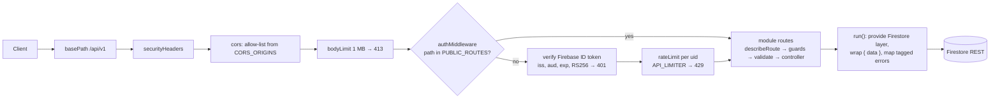
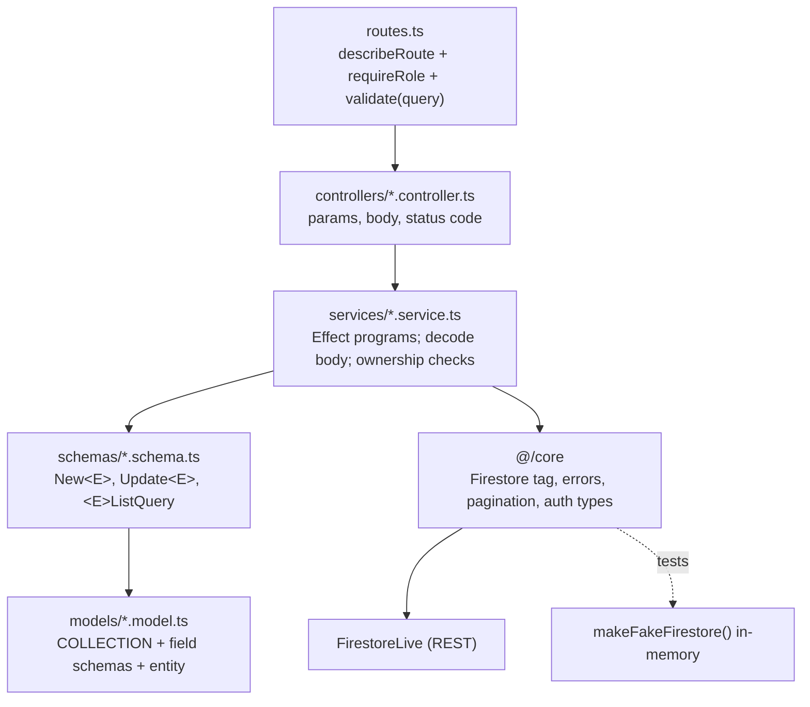
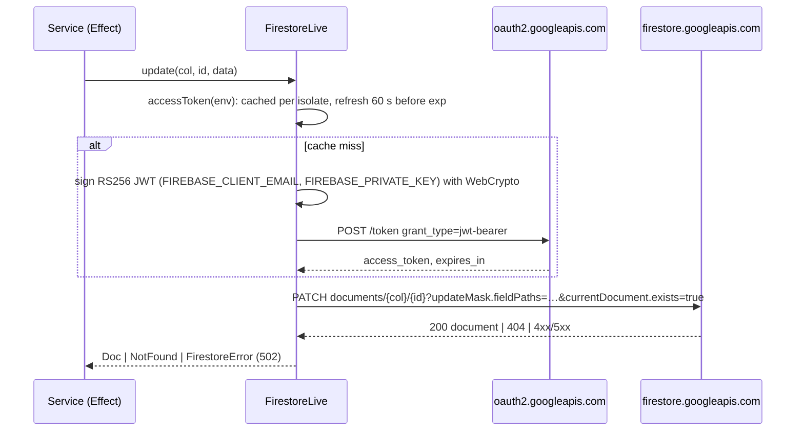
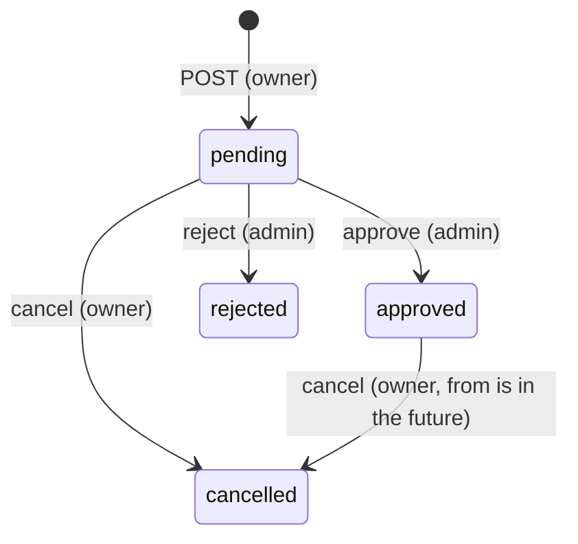

# Architecture — standalone REST API on Cloudflare Workers

This is the source of truth for the template in `plugins/api-dev/templates/` and for the rules the skills follow. A mismatch between this document and the code is a bug in one of them; fix that one.

Scope: one Worker, one repo, Firestore as the only datastore, Firebase ID tokens for callers. Not a monorepo, no Durable Objects, Queues or D1.

## 1. Request pipeline

Order matters: a route mounted outside this chain, or a middleware placed before auth, bypasses what every handler assumes has run. `OPTIONS` requests pass auth so CORS preflight works.

Public routes (no token): `/api/v1/health`, `/api/v1/docs`, `/api/v1/openapi.json`. Everything else needs `Authorization: Bearer <Firebase ID token>`.

## 2. Module layering

| Layer | Owns | Never |
|---|---|---|
| `models/` | collection name, field schemas, entity schema and type | imports Hono or Firestore |
| `schemas/` | DTOs clients may send; each has an `identifier` for OpenAPI | logic |
| `services/` | one exported Effect program per use case; body decoding; ownership and state checks | touches Hono `Context` |
| `controllers/` | read params/query/body, call a service, choose 200/201/204 | decides anything |
| `routes.ts` | path → `describeRoute` → guards → `validate` → handler | computes anything |
| `index.ts` | `export const <plural>Module = { path, routes }` | — |

Imports flow one way: routes → controllers → services → schemas/models → `@/core`. A module never imports another module; shared things go to `core/`. Modules register in `src/modules/index.ts`; an unregistered module typechecks and 404s.

## 3. Data access

The `Firestore` service tag is the only way a service reaches data. Operations:

| Operation | Behaviour |
|---|---|
| `list(col, { limit, cursor })` | one page ordered by document id; cursor is Firestore's `pageToken` |
| `query(col, { where, orderBy, limit, cursor })` | `:runQuery` with structured filters; cursor encodes the last document's sort values + id (base64, opaque to clients) |
| `get(col, id)` | `NotFound` when missing; ids are URL-encoded |
| `create(col, data)` | Firestore generates the id; `createdAt`/`updatedAt` set by the adapter |
| `update(col, id, data)` | `updateMask` = keys of `data`; `currentDocument.exists=true` so a missing doc is `NotFound`, never an upsert; `updatedAt` refreshed |
| `remove(col, id)` | `NotFound` when missing (no silent 200) |

Value encoding: string, number (`integerValue` / `doubleValue`), boolean, null, array, map, and `Date` ↔ `timestampValue` (ADR: dates are timestamps, not strings). Nothing else is encoded; a new type needs an adapter test.

## 4. Collections

Every document carries the server-owned fields below. They are never accepted from a request body.

| Field | Type | Set by |
|---|---|---|
| `id` | string | Firestore |
| `ownerId` | string (Firebase uid) | service, from the verified token |
| `createdAt`, `updatedAt` | timestamp | adapter |

### `items` (minimal CRUD, what the generator copies)

| Field | Type | Rule |
|---|---|---|
| `name` | string | non-empty, trimmed, ≤ 120 |
| `qty` | integer | ≥ 0 |

### `timeOffRequests` (domain example: ownership, state, roles)

| Field | Type | Rule |
|---|---|---|
| `type` | `"annual" \| "sick" \| "unpaid"` | required |
| `from`, `to` | timestamp (date at 00:00 UTC) | `from <= to`; span ≤ 30 days |
| `reason` | string | ≤ 500, may be empty |
| `status` | `"pending" \| "approved" \| "rejected" \| "cancelled"` | server-owned; starts `pending` |
| `decidedBy` | uid or null | admin who approved/rejected |
| `decidedAt` | timestamp or null | set with `decidedBy` |

State machine:

Any other transition fails with `409 CONFLICT`. Only `pending` requests may be edited (`PATCH`), and only by their owner.

## 5. Queries and indexes

| Endpoint | Access pattern | Index |
|---|---|---|
| `GET /items` | all, by id | none (collection list) |
| `GET /timeOffRequests` as user | `ownerId == me` ordered `createdAt desc` | composite (`ownerId` asc, `createdAt` desc) |
| `GET /timeOffRequests` as admin | optional `status ==`, ordered `createdAt desc` | composite (`status` asc, `createdAt` desc) |
| `GET /timeOffRequests?from=&to=` | `from >= a AND from <= b` plus `ownerId` or `status` equality; ordered by `from asc` because Firestore requires the first `orderBy` to be the range field | composite (`ownerId` asc, `from` asc), (`status` asc, `from` asc) |

Firestore allows range filters on one field per query, and that field must lead the `orderBy`. A list with a date range is therefore ordered by `from`, not `createdAt`; the response documents which order applies.

Indexes live in `firestore.indexes.json` in the template and are deployed with `firebase deploy --only firestore:indexes` (or created from the console link Firestore prints on the first failing query). A query that needs an index the file does not declare is a bug.

Pagination contract: `?limit=1..100` (default 20) and an opaque `cursor`. The response's `meta.pagination.cursor` is absent on the last page. A tampered cursor answers `400 BAD_REQUEST "Invalid cursor"`.

## 6. Authorization

Two questions, two checks. `authMiddleware` answers *who*; the route and the service answer *may they*.

| Endpoint | anonymous | user (owner) | user (other) | admin |
|---|---|---|---|---|
| `GET /health`, `/docs`, `/openapi.json` | 200 | 200 | 200 | 200 |
| `GET /items`, `GET /items/:id` | 401 | 200 | 200 | 200 |
| `POST /items`, `PATCH /items/:id` | 401 | 201 / 200 | 403 on PATCH | 200 |
| `DELETE /items/:id` | 401 | 403 | 403 | 204 |
| `GET /timeOffRequests` | 401 | own only | own only | all |
| `GET /timeOffRequests/:id` | 401 | 200 | 404 (not 403: existence is not leaked) | 200 |
| `POST /timeOffRequests` | 401 | 201 | 201 (own) | 201 |
| `PATCH /timeOffRequests/:id` | 401 | 200 if pending | 404 | 200 if pending |
| `POST …/:id/approve`, `/reject` | 401 | 403 | 403 | 200 |
| `POST …/:id/cancel` | 401 | 200 | 404 | 200 |

- Role comes from the Firebase custom claim `role` (`"admin"`); absent means `user`. Set with the Admin SDK from a trusted script, never by the API.
- `requireRole("admin")` guards routes in `routes.ts`. Ownership and state checks live in the service and fail with `Forbidden` or `Conflict`.
- Reads of another user's record return 404, not 403, so ids cannot be enumerated.

## 7. Environments and secrets

| | local (`wrangler dev`) | `dev` | `stag` | `prod` |
|---|---|---|---|---|
| Worker name | `my-api` | `dev-my-api` | `stag-my-api` | `prod-my-api` |
| `FIREBASE_PROJECT_ID` (var) | `.dev.vars` | `[env.dev.vars]` | `[env.stag.vars]` | `[env.prod.vars]` |
| `CORS_ORIGINS` (var) | `http://localhost:3000` | app-dev origin | app-stag origin | app-prod origin |
| `FIREBASE_CLIENT_EMAIL`, `FIREBASE_PRIVATE_KEY` (secrets) | `.dev.vars` | `wrangler secret put --env dev` | `--env stag` | `--env prod` |
| `API_LIMITER` (binding) | top-level `[[ratelimits]]` | `[env.dev] ratelimits` | `[env.stag] ratelimits` | `[env.prod] ratelimits` |

Bindings and vars are not inherited between envs: every env declares its own. A missing `API_LIMITER` means no rate limiting; `deploy-api` checks before deploying.

## 8. Error contract

Success: `{ data }`; lists: `{ data: [...], meta: { pagination: { limit, cursor? } } }`; `201` on create, `204` on delete, `200` on everything else.

| Status | `code` | Raised by |
|---|---|---|
| 400 | `BAD_REQUEST` | schema decode (body), `validate()` (query/param), bad cursor |
| 401 | `UNAUTHORIZED` | `authMiddleware` |
| 403 | `FORBIDDEN` | `requireRole`, ownership check |
| 404 | `NOT_FOUND` | missing document, or a document the caller may not see |
| 409 | `CONFLICT` | invalid state transition |
| 413 | `PAYLOAD_TOO_LARGE` | body limit |
| 429 | `RATE_LIMITED` | rate limiter |
| 502 | `UPSTREAM_ERROR` | Firestore or OAuth failure; body never includes upstream details |

Validation messages are `"<field>: <reason>"`, first issue only. Every failure is a tagged error mapped in one place (`core/http.ts`); a `throw` inside a service is a defect (500) and a bug.

## 9. Dates and times

Stored as Firestore `timestampValue`; exposed as ISO 8601 strings in JSON; validated with `Schema.DateFromString` at the boundary. Date-only values (`from`, `to`) are midnight UTC. No local-time arithmetic anywhere in the Worker.

## 10. Decisions

- **Effect Schema and Effect programs, not Zod.** One schema serves validation, decoding and the OpenAPI spec; services are Effect programs so every failure is a typed, mapped error rather than a `throw`. Zod would have needed a second layer for the Effect services. Cost: a steeper learning curve, carried by the template and the generator.
- **`effect` pinned to 3.x.** 4.x changes the Schema API; upgrade deliberately, with the adapter tests as the gate.
- **Firestore over REST, no SDK.** `firebase-admin` does not run on Workers; the REST adapter is small and fully testable with a stubbed `fetch`.
